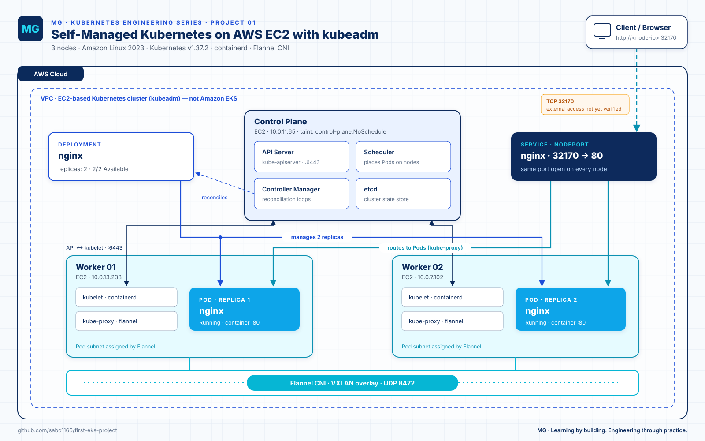

# Project 01 — Self-Managed Kubernetes Cluster on AWS EC2 (kubeadm)

> **MG | Kubernetes Engineering Series**
> Learning by building. Engineering through practice.



> **Note on the repository name:** this repo is called `first-eks-project`, but Project 01 is
> **not Amazon EKS**. It is a **self-managed** Kubernetes cluster built by hand with `kubeadm`
> on three EC2 instances. Amazon EKS (a managed control plane) is planned for a later project.

## What this project is

A three-node Kubernetes cluster, bootstrapped from bare Amazon Linux 2023 instances, with no
managed Kubernetes service involved. The goal was to understand what a managed service hides:
the container runtime, the kernel prerequisites, the control-plane bootstrap, node joining, the
pod network, and how a workload ends up scheduled and exposed.

## Learning objectives

- Prepare Linux hosts for Kubernetes (container runtime, cgroups, kernel modules, sysctl).
- Bootstrap a control plane with `kubeadm init` and join workers with `kubeadm join`.
- Understand the roles of the API Server, Scheduler, Controller Manager, etcd and kubelet.
- Install a CNI plugin (Flannel) and understand cross-node Pod networking.
- Deploy a replicated workload and observe how the scheduler spreads it across workers.
- Expose a workload with a `NodePort` Service.

## Cluster inventory

| Role | OS | Kubernetes | Runtime | Private IP |
|---|---|---|---|---|
| Control Plane | Amazon Linux 2023 | v1.37.2 | containerd | `10.0.11.65` |
| Worker 01 | Amazon Linux 2023 | v1.37.2 | containerd | `10.0.13.238` |
| Worker 02 | Amazon Linux 2023 | v1.37.2 | containerd | `10.0.7.102` |

EC2 console evidence (16 Nov 2026, [`screenshots/00-ec2-instances-running.png`](screenshots/00-ec2-instances-running.png)):
all three instances **Running** in `us-east-1` — control plane `t3.medium`, workers `t3a.medium`.

> ⚠️ **To reconcile:** in the EC2 console, the instance *named* `k8s-worker-01` has private IP
> `10.0.7.102` and `k8s-worker-02` has `10.0.13.238` — the reverse of the table above. Confirm
> with `kubectl get nodes -o wide` which Kubernetes node is which, then align names and docs.

CNI: **Flannel** (official manifest) · Workload: **Nginx Deployment, 2 replicas** ·
Exposure: **NodePort Service on port 32170**

## Project status

| # | Step | Status |
|---|---|---|
| 1 | Three EC2 instances created | ✅ Done |
| 2 | Security group communication between nodes | ✅ Done |
| 3 | containerd installed on all nodes, `SystemdCgroup = true` | ✅ Done |
| 4 | Kernel modules, sysctl networking, SELinux permissive | ✅ Done |
| 5 | kubeadm / kubelet / kubectl v1.37.2 installed | ✅ Done |
| 6 | Control plane initialised with `kubeadm init`, kubectl configured | ✅ Done |
| 7 | Flannel CNI installed | ✅ Done |
| 8 | Worker 01 and Worker 02 joined with `kubeadm join` | ✅ Done |
| 9 | All three nodes `Ready` | ✅ Verified |
| 10 | Nginx Deployment 2/2 Available, both Pods `Running` | ✅ Verified |
| 11 | One Pod scheduled on each worker | ✅ Verified |
| 12 | NodePort Service created (port 32170) | ✅ Created |
| 13 | External access to Nginx from a browser | ⏳ **Not yet confirmed** |

See [What is not yet complete](docs/project-roadmap.md#project-01--open-items).

## Documentation

| Document | Contents |
|---|---|
| [Architecture](docs/architecture.md) | Components, responsibilities, networking and traffic flow |
| [Implementation steps](docs/implementation-steps.md) | Every step, with commands and explanations |
| [Troubleshooting](docs/troubleshooting.md) | Errors encountered and diagnostic commands |
| [Lessons learned](docs/lessons-learned.md) | Engineering takeaways, security and cost notes |
| [Project roadmap](docs/project-roadmap.md) | Open items and the 12-project series |

## Repository layout

```text
.
├── README.md
├── docs/            # architecture, implementation, troubleshooting, lessons, roadmap
├── diagrams/        # architecture.mmd (editable) + architecture.svg / .png
├── screenshots/     # real terminal/console evidence (to be added)
├── linkedin/        # post, video script, carousel outline, video assets
└── LICENSE
```

## Security note

No bootstrap tokens, CA hashes, certificates, kubeconfig files or AWS credentials are stored in
this repository. Commands that would contain them use placeholders such as `<TOKEN>` and
`<CA_CERT_HASH>`.

## Author

**MG** — Cloud & DevOps Engineering · [github.com/sabo1166](https://github.com/sabo1166)
